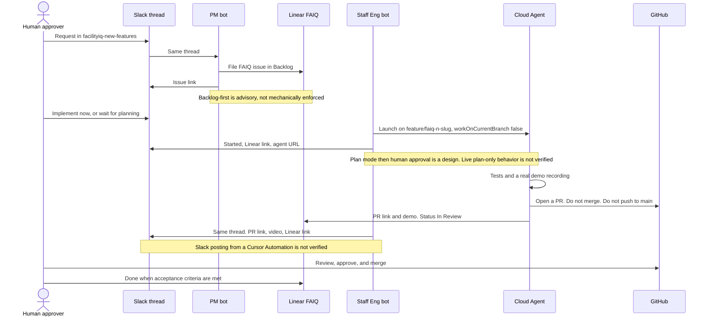

# Automation spec: Slack → Linear → Cloud Agent → PR

Spec only. Cursor Automations are created by Joe in the Cursor UI (`cursor.com/automations`, or `/automate` in the Agents window). Committing this file does not create or enable an automation. Slack posting from an automation is **not verified**. The Cloud Agents helper is **UNTESTED** against a live key.

|                    |                                                                                                                                                                                                               |
| ------------------ | ------------------------------------------------------------------------------------------------------------------------------------------------------------------------------------------------------------- |
| Linear issue       | [FAIQ-35](https://linear.app/acme-ai/issue/FAIQ-35/chore-document-the-slack-linear-cloud-agent-pr-flow-with-status-in)                                                                                        |
| Gates and personas | [`bot/approval-flow.md`](../bot/approval-flow.md)                                                                                                                                                             |
| Optional launcher  | `scripts/cursor-api/launch-agent.mjs` (UNTESTED)                                                                                                                                                              |
| Standards          | Notion [Linear: Issues, Backlog, and Sprints](https://app.notion.com/p/413dfbf62ea381ab91e7c5dafaeef034) section 7, and [Guardrails & Automations](https://app.notion.com/p/415dfbf62ea3815c9f3cf14f3ff9565b) |
| Notion follow-up   | The Guardrails & Automations page should link to this file, to `bot/approval-flow.md`, and to `scripts/cursor-api/launch-agent.mjs`. This change does not edit Notion.                                        |

Parent issue: [FAIQ-29](https://linear.app/acme-ai/issue/FAIQ-29/nextjs-convention-guardrails-for-new-engineer-onboarding). This spec does not implement [FAIQ-36](https://linear.app/acme-ai/issue/FAIQ-36/finance-managers-can-see-operating-cost-by-category-labor-maintenance).

## Who acts

| Step | Who                          | What they do                                                                                                                                                                                                                                                                                | Where status is posted                                                                                    |
| ---- | ---------------------------- | ------------------------------------------------------------------------------------------------------------------------------------------------------------------------------------------------------------------------------------------------------------------------------------------- | --------------------------------------------------------------------------------------------------------- |
| 1    | Human                        | Posts the request as a new thread in `#facilityiq-new-features`.                                                                                                                                                                                                                            | The Slack thread is the request and the later status view.                                                |
| 2    | PM bot                       | Files one FAIQ issue before anyone implements. Team FacilityIQ, exactly one label (Feature, Bug, or Improvement; a chore is Improvement with title prefix `Chore:`), template and acceptance criteria from the Linear page, status **Backlog**, no cycle.                                   | Linear issue, status Backlog. Then a short note in the same Slack thread with the issue link.             |
| 3    | Human                        | If the request is "implement now", says so. Planning would otherwise move Backlog → Todo. "Implement now" still starts from the issue filed in step 2.                                                                                                                                      | Slack thread.                                                                                             |
| 4    | PM bot or the human assignee | Moves the issue to **In Progress** once a branch exists. Assigns it.                                                                                                                                                                                                                        | Linear status In Progress.                                                                                |
| 5    | Staff Eng bot                | Launches a Cloud Agent. The branch name includes the issue id (`feature/faiq-<n>-<slug>`). `startingRef` is `main` only because `develop` does not exist, or the stacked parent branch when the ticket names one. `workOnCurrentBranch` stays false so the run does not push onto that ref. | Slack thread: "started", with the Linear link and the Cloud Agent URL (`https://cursor.com/agents/bc-…`). |
| 6    | Cloud Agent                  | Implements on that branch. Runs the checks the change needs. Records a real demo, or writes why a video cannot be made. Does not invent a clip.                                                                                                                                             | Still In Progress. The agent does not merge.                                                              |
| 7    | Cloud Agent                  | Pushes the feature branch and opens a GitHub PR for human review. Title `<type>(<scope>): <outcome> [FAIQ-<n>]`. Body is `.github/pull_request_template.md`.                                                                                                                                | GitHub PR. Linear moves to **In Review**. The PR link and the demo video are posted on the Linear issue.  |
| 8    | Staff Eng bot                | Replies in the **same Slack thread** with the demo, the PR link, and the Linear link. Names only checks that actually ran.                                                                                                                                                                  | Slack thread: "PR ready".                                                                                 |
| 9    | Human approver               | Reviews, approves, and merges. Moves the issue to **Done** when the acceptance criteria are met.                                                                                                                                                                                            | GitHub merge. Linear Done. No agent posts a merge.                                                        |

Backlog-first (step 2) is **advisory**. `pnpm guard` does not fail when an issue was created in Todo or In Progress. A read-only Slack capture on Tue Nov 10, 2026 shows Staff Eng creating FAIQ-28 already In Progress, with no PM-bot step. This spec is the rule from that date forward. This change did not re-query Slack, so current bot membership is **not verified**.

## Sequence



## Branch and pull request

GitFlow, as written on the Linear page:

| Ticket label               | Branch                    | PR base                              |
| -------------------------- | ------------------------- | ------------------------------------ |
| Feature or Improvement     | `feature/faiq-<n>-<slug>` | `develop`                            |
| Bug, not on production     | `bugfix/faiq-<n>-<slug>`  | `develop`                            |
| Bug on production / `main` | `hotfix/faiq-<n>-<slug>`  | `main`, then back-merge to `develop` |

Known deviation: this repository has no `develop` branch. Do not create it. Until a maintainer adds it, the PR base is `main`, or the head branch of a stacked parent PR. Say that in the PR body.

Second known deviation, from the public Cloud Agents API docs (fetched for this change, **not verified** with a live key): when `workOnCurrentBranch` is false, Cursor pushes a new `cursor/…` branch based on `startingRef`. The prompt still asks for `feature/faiq-<n>-<slug>`. If the platform keeps the `cursor/…` name, the PR's GitFlow section records the deviation. Do not force-push to rename. Do not set `workOnCurrentBranch` true to "fix" the name. True means the agent pushes onto `startingRef`, which would push to `main` when that ref is `main`.

Agents never merge. Agents never push to `main`. The shell hook's deny list covers `gh pr merge` and force-push. It does not cover a plain push of `main`. That remains a process rule.

## Launcher (optional, UNTESTED)

`scripts/cursor-api/launch-agent.mjs` is the explicit Cloud Agents API bridge. It reads `CURSOR_API_KEY` only from the environment. It does not read `.env`, does not accept the key as an argument, and does not print the key. Printed success bodies are an allowlist: launch ids, status (`ACTIVE` / `IDLE` / `ARCHIVED` and the documented run statuses), GitHub pull request URLs, and steer `delivery` plus `runId`. Every stdout and stderr line from a command that has the key is passed through `redact`. A `latestRunId` that is not `run-<uuid>` is rejected and is not placed in a URL. Raw response bodies are not printed. The variable is commented out in `.env.example` so it is documented and unset. The app, worker, Compose, and CI do not read it.

```bash
node scripts/cursor-api/launch-agent.mjs --help
# plan mode, no PR, until a human approves the plan:
CURSOR_API_KEY=... node scripts/cursor-api/launch-agent.mjs launch FAIQ-35 "ticket text"
# only after that human approval:
CURSOR_API_KEY=... node scripts/cursor-api/launch-agent.mjs launch FAIQ-35 "ticket text" --agent
CURSOR_API_KEY=... node scripts/cursor-api/launch-agent.mjs status bc-00000000-0000-0000-0000-000000000001
CURSOR_API_KEY=... node scripts/cursor-api/launch-agent.mjs steer bc-00000000-0000-0000-0000-000000000001 "add the regression test"
```

`--ref <branch>` changes `startingRef` (default `main`, because `develop` does not exist). It does not turn on `workOnCurrentBranch`.

Local tests in `scripts/cursor-api/launch-agent.test.mjs` cover argument checks, the plan-mode default, HTTP error redaction, the `workOnCurrentBranch` refusal (the injected `fetch` is not called), and success-body allowlisting. They do not call `api.cursor.com`. A live key was not used. Treat every API field as **UNTESTED** until someone runs it and records the HTTP result.

The script does not post to Slack and does not comment on Linear. Those posts are the Staff Eng bot's step 5 and step 8. Wiring either post to this script is **not verified**.

## What this automation must not do

- Merge, approve, close, or dismiss a review on a pull request.
- Push to `main` or `develop`, force-push, tag, or dispatch a deploy.
- Skip filing the Linear issue, or file it with a status other than Backlog when the writer can choose. The guard will not catch a skip.
- Put a token, key, or `.env` value in the prompt, the PR, Slack, or Linear.
- Claim a check passed, a video exists, or an automation is live unless that run observed it.
- Implement FAIQ-36 or edit an unrelated in-flight PR.

## Not verified

- Live `CURSOR_API_KEY` and every Cloud Agents response field (`mode`, `autoCreatePR`, `workOnCurrentBranch`, run `git.branches[].prUrl`).
- Slack posting from a Cursor Automation. The Nov 10 capture shows Staff Eng bot posts, which is a different actor.
- That Staff Eng will stay in plan mode until a human says to implement.
- A Linear view named "FacilityIQ: In flight".
- GitHub branch protection or required reviews. This spec does not change repository settings.
- Current Slack membership of a PM bot. The Nov 10 capture did not find one, and this change did not search Slack again.
